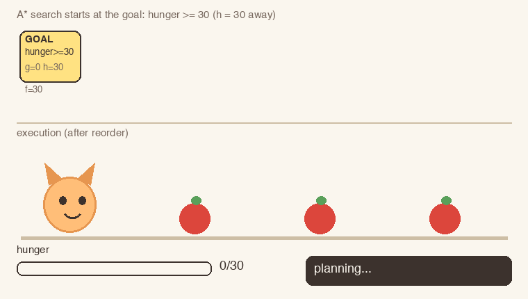

# SoPets.GOAP

A Goal-Oriented Action Planning (GOAP) library in C# (.NET 8). It was written for the pet AI in [SoPets](https://github.com/SoPets/CCDS-SEP-Project-Updates) as a proof-of-concept.

> [!WARNING]
> This project is not production-ready and is not suitable for use in a project in its current state. It is no longer maintained.



*An illustration of the demo plan below: the search graph on top, the plan acted out underneath. It was drawn from the real plan with a separate script and is not generated by this repo.*

## How it works

GOAP lets a character work out *what to do* by planning a chain of actions, instead of following a fixed script.

GOAP was popularised by Jeff Orkin's AI for the game *F.E.A.R.* (2005), described in [Three States and a Plan: The A.I. of F.E.A.R.](https://www.gamedevs.org/uploads/three-states-plan-ai-of-fear.pdf) (GDC 2006). Its actions with preconditions and effects come from the STRIPS planner (Fikes and Nilsson, 1971), and it uses A* to search for the chain of actions.

### How state is modelled

- **Beliefs** are the world state: a dictionary from a key to a value. A key (`SPWorldKey`) is a belief type plus an optional item, such as `HUNGER`, `IS_AT_POSITION` or `SAW_ITEM (FOOD, 3)`. A value (`Datum`) is a typed int, float, 2D vector, bool or string.
- **A goal** is a set of conditions. Each is a key plus a requirement on its value (`>=`, `<=`, `==` or in-between), such as `HUNGER >= 30`.
- **An action** has preconditions (conditions that must hold), effects (`Set`, `Increment`, `Decrement` or `Remove` on a key), a cost, and settings, which are the parameters of one use of the action, such as which food to eat. *Eat food* needs `IS_AT_POSITION == the food` and increments `HUNGER` by 10. *Move to target* sets `IS_AT_POSITION`.

### How it is searched

The planner uses **regression planning**: it searches backwards from the goal with A*, and each action's effects update ("regress") the subgoals.

1. Start with the goal's conditions as the **subgoals**: what is still not true.
2. Pick an action whose effects touch a subgoal. Applying it updates the subgoals: after *eat food*, `HUNGER >= 30` becomes `HUNGER >= 20`, and the action's own precondition (be at the food) is added.
3. Repeat. The search stops when every subgoal is already true in the character's starting beliefs.
4. Read the chain of actions backwards. That is the plan.

Each search node stores its action and parent, its remaining subgoals, and the beliefs with the chosen effects applied. It also stores three costs:

- **g**: the cost of the actions chosen so far.
- **h**: a guess of the distance left, which is how far the remaining subgoals are from the starting beliefs.
- **f = g + h**: the score. A* always expands the node with the lowest f next, from a priority queue.

A state that was already reached more cheaply is skipped. The search has a small budget (1000 iterations, 100 queued nodes). If it runs out, it returns the best partial plan that is still valid.

Each node also keeps a **forward state**: the starting beliefs with the effects of the chosen actions applied. Actions read it to choose their settings, such as which food is nearest. The chain is built backwards, so this state describes what happens *after* the current action in time, not before it. The search therefore cannot see the walk from the starting position, and the plan can visit food in a poor order. A last step reorders the move+eat pairs nearest-first.

Built-in goals: `SATISFY_HUNGER`, `WANDER`. Built-in actions: `MOVE_TO_TARGET`, `EAT_FOOD`, `WANDER`.

## Run the demo

```sh
dotnet run --project SoPets.GOAP.Demo
```

An agent at `(0, 0)` sees three food items and plans to satisfy hunger:

```
MOVE_TO_TARGET((1,0)) -> EAT_FOOD((1,0)) -> MOVE_TO_TARGET((2,0)) -> EAT_FOOD((2,0)) -> MOVE_TO_TARGET((3,0)) -> EAT_FOOD((3,0))
```

## Known limits

- Only two goals and three actions, with placeholder values: the wander target and the hunger bonus are fixed.
- The final reorder is greedy and assumes the move+eat pairs are independent.
- The planner keeps its search state in static fields, so it is not thread-safe.
- There are no tests.

## License

MIT
